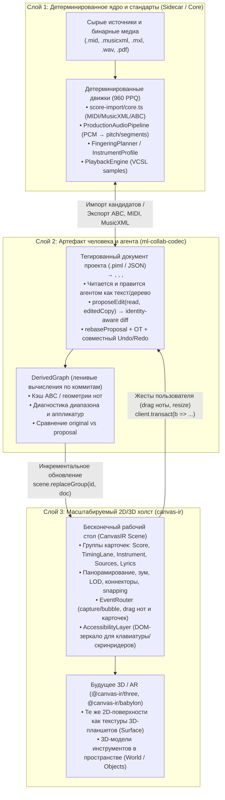

# Portable Instruments — Архитектура 3 слоёв: Музыкальные стандарты + `ml-collab-codec` + `canvas-ir`

Статус: **принятое архитектурное решение для единого рабочего пространства человека и агента**  
Связанные библиотеки организации `AnimaticML`:
- **[`AnimaticML/ml-collab-codec`](https://github.com/AnimaticML/ml-collab-codec)** — схемно-определённые совместные документы (читаемый тегированный исходник ↔ JSON, идентичностный diff, `proposeEdit` / `rebaseProposal` для работы агента с артефактом целиком, OT-синхронизация, совместный `Undo/Redo`, `DerivedGraph`).
- **[`AnimaticML/canvas-ir`](https://github.com/AnimaticML/canvas-ir)** — типизированное промежуточное представление 2D-графики (`RecordingContext`, `Scene`, `Renderer`, `Components`, `VirtualGroup`, `EventRouter`, `@canvas-ir/text`, `EmbedLayer`, `AccessibilityLayer` и прямой мост в 3D через `@canvas-ir/three` / `@canvas-ir/babylon`).

---

## 1. Главный принцип: строгое разделение 3 слоёв и форматов данных

Чтобы не смешивать тяжёлые бинарные данные, логику совместной работы человека с агентом и высокоскоростную графику, система строится из **трёх изолированных слоёв**, у каждого из которых свой формат и своя ответственность:



---

## 2. Слой 1: Детерминированное ядро и существующие стандарты (не пихаем бинарники в документ агента!)

Все внутренние вычислительные функции и обмен с внешним музыкальным миром опираются исключительно на проверенные индустриальные стандарты и детерминированные алгоритмы:

1. **Форматы хранения и обмена (Sidecar-ресурсы, адресуемые по `sha256`):**
   - **Standard MIDI (`.mid`)** — стандарт для многодорожечных событий, выхода AMT-моделей (`MuScriptor`, `YourMT3+`, `Basic Pitch`) и железных инструментов.
   - **MusicXML 4.0 (`.musicxml` / `.mxl`)** — стандарт для обмена партитурами и выхода OMR (`Audiveris`).
   - **ABC Notation (`.abc`)** — компактный стандарт для гравировки через `abcjs` и передачи в существующий движок практики.
   - **PCM / WAV (`.wav`)** — стандарт для аудиозаписей, сэмплов и выхода генератора музыки (`ACE-Step`).
2. **Почему это отделено от документа агента:**
   - В документ `ml-collab-codec` **никогда не записываются** гигантские массивы `pitchTrace` (50 кадров в секунду), сырые PCM-буферы или тысячи неквантованных MIDI-событий из 16 дорожек аккомпанемента.
   - Они хранятся рядом как неизменяемые (`immutable`) контент-адресуемые блобы (`sha256`), а в документ `ml-collab-codec` попадают только **компактная ссылка (`ref="sha256:..."`) + сводка кандидатов + выбранная монофоническая линия**, с которой реально работают человек и агент.

---

## 3. Слой 2: Документ проекта на `ml-collab-codec` (Артефакт вместо набора RPC-функций)

Вместо того чтобы заставлять LLM-агента вызывать десятки мелких функций (`setPitch(id, 64)`, `setDuration(id, 480)`), проект представляется как **единый схемно-валидируемый документ `ml-collab-codec`**.

### 3.1. Как выглядит артефакт для агента и человека

Благодаря двустороннему кодеку `parseDocument` ↔ `serializeDocument`, один и тот же проект является:
- в рантайме — нормализованной таблицей (`Table` с `readonly` строками и структурным шерингом);
- для агента и гита — компактным, идеально читаемым тегированным документом с постоянными `id`:

```xml
<project id="proj-scarborough" title="Scarborough Fair" tempo="84" meter="3/4" key="Dm" prefer="flats">
  <source id="src-midi" kind="midi" file="scarborough.mid" sha256="e3b0c442..." selectedCandidate="cand-vocal" />

  <arrangement id="arr-main" instrument="harmonica-c12" ppq="960">
    <measure id="m1" number="1">
      <note id="n1" start="0" dur="960" midi="62" pitch="D4" src="raw-1" />
      <note id="n2" start="960" dur="480" midi="62" pitch="D4" src="raw-2" />
      <note id="n3" start="1440" dur="480" midi="69" pitch="A4" src="raw-3" />
    </measure>
    <measure id="m2" number="2">
      <note id="n4" start="1920" dur="960" midi="69" pitch="A4" tie="start" src="raw-4" />
      <rest id="r1" start="2880" dur="960" />
    </measure>
  </arrangement>

  <lyrics id="lyr-en" lang="en" level="B1">
    <stanza id="st-1" role="verse">
      <line id="l1" measures="1..2">Are you going to Scarborough Fair?</line>
    </stanza>
  </lyrics>

  <board id="board-layout" cameraX="0" cameraY="0" cameraZoom="1">
    <card id="card-score" target="arr-main" x="120" y="80" w="920" h="420" />
    <card id="card-inst" target="arr-main" view="instrument" x="120" y="540" w="920" h="260" />
    <card id="card-src" target="src-midi" x="-360" y="80" w="440" h="360" />
    <connector id="conn-1" from="card-src" to="card-score" />
  </board>
</project>
```

### 3.2. Что это даёт из коробки

1. **Агент редактирует артефакт, а не вызывает функции:**
   - Агент читает снимок документа на ревизии `r` (или его поддерево, например такты 9–12, или экспортированную через `exportDocument(schema, provider)` схему для structured output).
   - Агент возвращает новую версию фрагмента (например, упрощённую для калимбы мелодию или переписанный куплет текста).
   - `proposeEdit({ table: A, revision: r }, B, { replica: "agent", seq })` автоматически вычисляет **identity-aware diff** (`diffToChanges`): сопоставляет ноты по их стабильным `id="n1"`, не пересоздаёт неизменённых соседей и раскладывает текстовые правки по отдельным `textHunks`.
2. **Человек и агент не блокируют друг друга (`rebaseProposal`):**
   - Пока агент думал над тактами 9–12, человек мог подвинуть ноту в такте 2 или передвинуть карточку на холсте.
   - `rebaseProposal(proposal, authority)` чисто переносит предложение агента поверх правок человека через Operational Transformation (OT).
3. **Визуальный превью-дифф и совместный Undo/Redo:**
   - Пока предложение агента находится в статусе `pending`, `DerivedGraph` строит из `proposal.changes` оверлей для холста: старые позиции нот рисуются полупрозрачным контуром (`ghost`), новые — ярко, с кнопками `[Listen] [Apply] [Reject]`.
   - Любое принятое действие человека или агента откатывается штатным коллаборативным `Undo/Redo`.
4. **Реактивный граф вычислений (`DerivedGraph`):**
   - Пересчёт строки ABC, гравировки, проверки диапазона гармоники/калимбы и планов аппликатуры (`FingeringPlanner`) регистрируется в `DerivedGraph`.
   - Если пользователь просто передвинул карточку `<card id="card-score" x="200">` на холсте, музыкальные узлы `<arrangement>` не затронуты — ни ABC, ни аудио, ни аппликатура **не пересчитываются** (`0` лишних вычислений).

---

## 4. Слой 3: Интерактивный масштабируемый 2D/3D холст на `canvas-ir`

Вместо традиционного веб-интерфейса из вложенных HTML-страниц, вкладок и модальных окон рабочее пространство строится как **единый масштабируемый холст (`CanvasIR Scene` + `Renderer`)** — рабочий стол музыканта, по которому можно свободно перемещаться (pan) и приближать/отдалять области (zoom).

### 4.1. Как устроено музыкальное рабочее место на `canvas-ir`

На одном холсте лежат связанные визуальные объекты (каждый в своей именной группе `ctx.beginGroup({ id, meta })`), соединённые живыми стрелками-коннекторами:

1. **Зона источников (`Source Cards`):**
   - Карточка импортированного MIDI / аудио / PDF-скана с компактным списком дорожек/кандидатов и мини-превью.
   - От выбранного кандидата тянется коннектор к карточке аранжировки (видно происхождение каждой мелодии!).
2. **Центральная зона партитуры и тайминга (`Score & Timing Surface`):**
   - Нотный стан (отрисованный в `RecordingContext` напрямую или через SVG/canvg-мост из `abcjs` с сохранением точных групп `note:n1`, `measure:m1`) + синхронная дорожка длительностей `TimingLane` прямо под ним.
   - Поскольку `Scene` в `canvas-ir` знает точную геометрию каждого пути (`scene.hitTest`, `scene.bounds`, `scene.queryPolygon`, `scene.snap`), выделение ноты кликом, лассо-выделение нескольких тактов, вертикальный drag ноты по ступеням стана и горизонтальный resize длительности работают в едином координатном пространстве через `EventRouter`.
   - Во время перетаскивания ноты `renderer.lift([noteGroupId])` кэширует всё под и над перетаскиваемым элементом в битмапы, обеспечивая гарантированные **60 FPS (< 16 мс)** даже на огромной партитуре.
   - Для длинных партитур используется `VirtualGroup`: записываются и рендерятся только те такты, которые попадают в текущий видимый прямоугольник камеры (`window`), а при отдалении камеры срабатывает уровень детализации (`detail` / LOD).
3. **Зона физического инструмента (`Instrument Surface`):**
   - Под партитурой (или рядом на столе) лежит интерактивная 2D-модель инструмента, отрисованная через `Components` в `canvas-ir`: хроматическая гармоника (с анимацией слайдера и отверстий), язычки калимбы, клавиатура мелодики или безладовые струны понтийской лиры с непрерывным маркером пальца и центами интонации.
4. **Зона текста и генерации (`Lyrics & Audio Surface`):**
   - Куплеты и припевы верстаются через `@canvas-ir/text` (`LiveText`, `layoutText`, `caretRect`, `selectionRects`) — с точным браузерным переносом строк, выделением текста и курсором прямо на холсте.
   - Для нативных видео/аудио-плееров (например, YouTube-референс или сгенерированные дубли `ACE-Step`) используется `EmbedLayer` (`ctx.embed(x, y, w, h)`), который вырезает точное окно в порядке отрисовки холста.
5. **HUD-слой поверх стола и Доступность (`AccessibilityLayer`):**
   - Компактная плавающая карточка транспорта (`Play / Wait for me / In time / BPM`), тулбар инструментов и `AgentDock` рисуются в отдельной HUD-сцене поверх стола (они остаются под рукой при зуме стола и не попадают в экспорт рисунка).
   - Каждая нота, кнопка и отверстие инструмента снабжаются метаданными `{ role, label, value }`, а `AccessibilityLayer` автоматически строит поверх `canvas` невидимое DOM-зеркало для навигации с клавиатуры (`Tab`, стрелки) и скринридеров.

### 4.2. Прямой и бесшовный переход в 3D и AR (`@canvas-ir/three` / `@canvas-ir/babylon`)

Поскольку весь 2D-интерфейс рисуется в `CanvasIR Scene`, переход к 3D не потребует переписывания ни одной кнопки и ни одного обработчика событий:
- Весь рабочий стол музыканта может становиться горизонтальной поверхностью стола в 3D-комнате, а любая карточка (например, партитура или инспектор) по двойному клику поднимается над столом как вертикальный 3D-планшет (`Surface`), сохраняя все клики и драги через единый `EventRouter` + `World` raycasting.
- Физические инструменты (гармоника, калимба, понтийская лира, мелодика) могут быть представлены как настоящие 3D-объекты (`Objects`), которые подсвечивают отверстия/язычки/струны в 3D, а с `@canvas-ir/motion` и камерой в будущем смогут даже отслеживать реальные руки и жесты музыканта в AR!

---

## 5. Как это ускоряет текущую и будущую разработку (план интеграции без потери времени)

Эта архитектура не противоречит тому, что уже написано в репозитории, а идеально ложится поверх него:

1. **Слой 1 у нас УЖЕ ЕСТЬ:**
   - `src/score-import/core.ts` (960 PPQ, MIDI, MusicXML, WAV, стратегии кандидатов), `ProductionAudioPipeline`, `FingeringPlanner`, `PlaybackEngine` и `AbcAdapter` остаются без переписывания как детерминированный **Слой 1**.
2. **В Этапе 1 (Route Fix + Score Correction Editor):**
   - Мы чиним статический роут `/harmonica/tools/score-import/` (через multi-page Vite).
   - Модель редактируемой аранжировки (`EditableArrangement` и обратимые операции редактирования) сразу проектируем так, чтобы она на 100% соответствовала табличной структуре и операциям `ml-collab-codec` (`<arrangement>` → `<measure>` → `<note>` / `<rest>` с детерминированными `id`), а визуальную сцену редактора и дорожку тайминга готовим к рендерингу через группы `canvas-ir`.
3. **В Этапе 2 (Подключение пакетов `ml-collab-codec` и `canvas-ir` и сборка бесконечного рабочего стола):**
   - Подключаем pinned-коммиты `AnimaticML/ml-collab-codec` и `AnimaticML/canvas-ir`.
   - Определяем `defineDocumentSchema` для музыкального проекта (`PortableInstrumentsSchema v1`).
   - Переводим рабочую область проекта на масштабируемый 2D-холст `canvas-ir` с карточками `Source`, `Score + TimingLane`, `Instrument`, `Lyrics` и `AgentDock`, соединёнными коннекторами и реактивным `DerivedGraph`.
