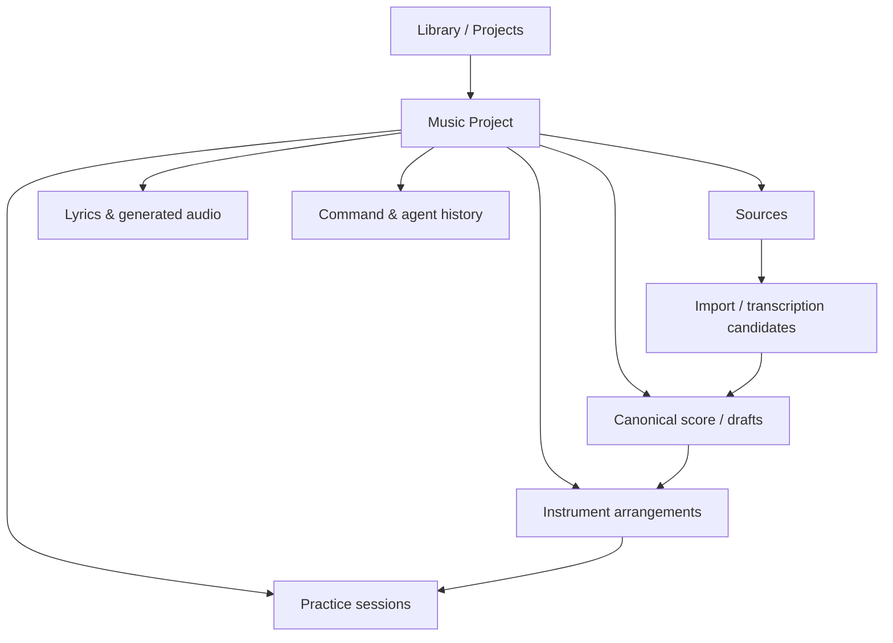
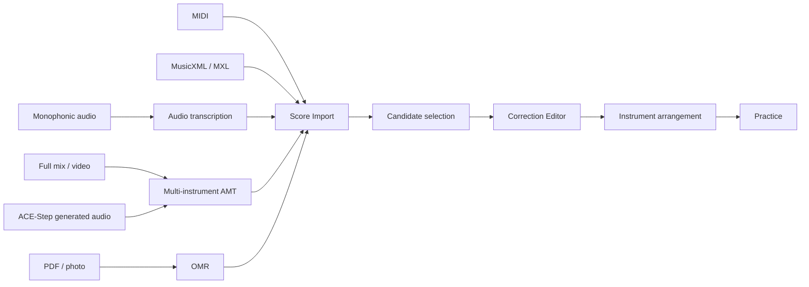

# Portable Instruments — Design Packet / All in One

Версия 1.0 · 17 ноября 2026

**Важно:** авторитетные детальные документы входят в ZIP по отдельности. Этот файл предназначен для однократной передачи контекста в систему с поддержкой одного Markdown-файла. Исходный handout хранится отдельно в `references/`.


## Содержание
- [01-product-vision](#01-product-vision)
- [02-information-architecture](#02-information-architecture)
- [03-user-journeys](#03-user-journeys)
- [04-screen-briefs](#04-screen-briefs)
- [05-visual-language](#05-visual-language)
- [06-notation-and-editor](#06-notation-and-editor)
- [07-instruments](#07-instruments)
- [08-agent-interaction](#08-agent-interaction)
- [09-creation-and-ingestion](#09-creation-and-ingestion)
- [10-layout-wireframes](#10-layout-wireframes)
- [11-concept-image-prompts](#11-concept-image-prompts)
- [12-design-review](#12-design-review)
- [13-design-decisions](#13-design-decisions)


---

<a id="01-product-vision"></a>

# 01. Видение продукта и рамки дизайна

## Одна фраза

**Portable Instruments** — персональное пространство для превращения музыкальной идеи или записи в редактируемую мелодию и её освоения на выбранном компактном инструменте.

«Portable Instruments» — рабочее название, не утверждённая идентичность бренда.

## История и точка роста

Продукт возник как браузерный тренажёр хроматической губной гармошки. Там уже прорабатывались abcjs-нотация, аппаратные аппликатуры 10/12 отверстий, микрофонный pitch detection, сенсорная модель инструмента, тренировка нот/слуха/ритма/песен, Step/Wait for me, In time, движущийся playhead, sample-based reference playback и импорт партитур. Позднее концепция была расширена до редактора и импортного workbench.

Теперь целевой продукт больше тренажёра: одна музыкальная работа может начинаться как MIDI, фотография нот, запись смартфона, видео, оригинальная песня или генерация, а закончиться личной аранжировкой, упражнением и записью собственного исполнения.

## Основные задачи человека

1. **Получить материал:** найти, импортировать, сфотографировать, записать или сгенерировать.
2. **Понять структуру:** увидеть источники, дорожки, голоса, результат распознавания и сомнительные места.
3. **Сделать собственную пьесу:** извлечь мелодические линии, исправить, связать, укоротить, упростить, транспонировать.
4. **Подобрать инструмент:** проверить диапазон и конкретное физическое отображение нот.
5. **Научиться играть:** тренироваться с настоящим инструментом, при необходимости в собственном темпе, затем под реальное время.
6. **Вернуться и улучшить:** сохранить, сравнить версии, узнать, почему упражнение сложное, изменить аранжировку.

## Отличие от смежных продуктов

| Не это | А это |
|---|---|
| Нотный редактор общего назначения | Узкий визуальный редактор мелодии с источниками и практикой |
| DAW с сотнями дорожек | Музыкальный workbench, ориентированный на партитуру, мелодию и инструмент |
| Отдельный AI-чат «сгенерируй мне MIDI» | Агент меняет текущую музыкальную работу и показывает действие |
| Сайт карточек обучающих мини-игр | Единый проект с практическими способами работы над музыкой |
| Каталог случайных коротких мелодий | Репертуар узнаваемых монофонических миниатюр 60–120 секунд |
| Игра ради достижений | Содержательное музыкальное действие; достижения могут появиться позже |

## Главные принципы — принятые

- **Workspace первичен.** Музыкальный контент занимает центр интерфейса, чат не заменяет его.
- **Один документ — несколько представлений.** Score, временная дорожка, инструмент, lyrics, waveform и source candidate связаны между собой.
- **GUI — для точных действий; агент — для намерения.** Ноту на полтона проще сдвинуть рукой; «упрости фразу» — задача агенту.
- **Интерфейс показывает причины и последствия.** Почему нота не засчиталась, что изменил агент, почему нельзя сыграть этот диапазон.
- **Нет ложного знания.** Звуковой анализ определяет высоту, но не притворяется, что однозначно распознал отверстие гармоники или струну лиры.
- **Компактно без скученности.** Не обводить одной широкой карточкой одну кнопку; группировать по смыслу.
- **Проверяемость и обратимость.** Любое значимое преобразование можно просмотреть, сравнить, отменить.
- **Локальная обработка, где разумно.** Источник остаётся у пользователя, если он явно не запустил облачную модель.

## Разделение текущего и будущего

### Существующий фундамент по исходному handout (сверить с кодом)

- Гармоника и pitch detection, визуализация инструмента, сенсорное управление.
- Нотное отображение abcjs и работа с временным положением.
- Режимы Find a Note, Practice a Song, Play by Ear, Rhythm Training.
- Wait for me / In time, результаты/ошибки и reference playback.
- Workbench импорта MIDI, MusicXML/MXL, mono WAV, экспорт в ABC/MIDI/MusicXML/JSON.
- Светлая/тёмная темы.

### Следующие продуктовые направления

- Визуальный correction editor и долговечные проекты/версии.
- Instrument abstraction + мелодика, MIDI-клавиатура, калимба.
- Агент с действиями над документом, diff и историей.
- OMR: PDF/изображение → MusicXML.
- AMT: сольная и многодорожечная музыка → MIDI-кандидаты.
- Генерация текста, песни (ACE-Step), транскрипция результата и практика.
- Источники видео/YouTube, учитывая доступность и права.
- Далее: флейта, окарина, ксилофон, понтийская лира и другие инструменты.
- Позже: импровизация, ачивменты и прогрессия.

## Как определить успех дизайна

- При открытии проекта сразу понятно: **какая музыка, на каком этапе, что можно сделать дальше**.
- От выбора песни до реальной практики нет длинного пути через технические настройки.
- При ошибке распознавания пользователь быстро находит и исправляет проблемную ноту.
- Агенту можно указать выделение и отдать команду, не объясняя ему заново, над каким проектом работаешь.
- Настройка для разных инструментов меняет не score, а его физическую проекцию/аранжировку.
- На обычном laptop viewport партитура видна рано; на телефоне — можно играть без блуждания по панелям.

## Не входит в задачу визуальной фазы

- Не реализовывать целиком движок OMR/AMT/ACE-Step.
- Не разрабатывать новую универсальную нотную систему вместо существующей без исследования.
- Не обещать автоматическую точную транскрипцию любой коммерческой песни.
- Не строить агентский UX вокруг однострочного «Prompt → готовая песня» вместо процесса просмотра и исправления.
- Не превращать программу в DAW или социальную сеть музыкантов.


---

<a id="02-information-architecture"></a>

# 02. Информационная архитектура

## Ключевая сущность — Music Project

Проект связывает источники и результаты. Одна песня может содержать исходный MIDI, PDF, несколько кандидатов извлечения, исправленный score, отдельные аранжировки для гармоники и калимбы, текст песни, генерированную дорожку, тренировки и историю действий.



**Принцип:** источник, интерпретация и пользовательская аранжировка — разные объекты. Исправления не должны уничтожать исходный материал.

## Предлагаемая карта приложения [Направление]

```text
Library / Projects
├── All projects
├── Songs / examples
├── Recent
└── New / Import / Record / Generate

Project workspace
├── Source        откуда материал и какие кандидаты
├── Edit          каноническая мелодия, коррекция, аранжировка
├── Instrument    физическая проекция на конкретном инструменте
└── Practice      исполнение, упражнения, результаты

Persistent agent: collapsed ↔ expanded
Project history: commands, versions, imports, approvals
```

Не утверждать вкладки как единственный navigation pattern. Визуально проверить два варианта:

- **A: project shell + компактная контекстная навигация**, центральный canvas меняется.
- **B: canvas-first + контекстные переключатели Source/Edit/Instrument/Practice**, без тяжёлой навигации.

Оба должны поддерживать прямой старт простого упражнения из главной библиотеки.

## Что должно оставаться постоянным

- Проект / название / статус сохранения.
- Текущая аранжировка / активный инструмент.
- Ключевой playback transport, если аудио/партитура открыты.
- Agent dock (последний обмен + поле ввода) или свернутая кнопка.
- Возможность вернуться к библиотеке.

## Выбор и фокус

Единый Selection Context:

```text
selection.kind = project | source | track | measure | note | note-range | lyric-line | instrument-position
selection.ids = stable IDs
selection.view = where the selection originated
```

Выбор ноты на score должен выделять соответствующий блок на timing lane, событие в инспекторе и связанную физическую позицию инструмента. Выделение MIDI-трека показывает его источник и preview, но не переписывает финальную аранжировку до явного действия.

## Состояния проекта и понятные переходы

1. **Empty project:** начни с Import / Record / Generate / Manual melody.
2. **Imported source, candidate missing:** пользователь выбирает линию; можно послушать варианты.
3. **Candidate ready:** Edit this candidate / Save as arrangement.
4. **Edited arrangement:** выбрать инструмент, проверить диапазон, подготовить практику.
5. **Practice-ready:** тренироваться, записывать попытку, возвращаться к редактору.
6. **Generated audio only:** транскрибировать или оставить аудиоисточником; score не изображать существующим.

Нельзя показывать шаг «редактировать ноты», пока система не получила символические ноты. Вместо ложного пустого score — честное состояние «Сначала получить транскрипцию».

## Продуктовые документы и версии

- **Source Asset:** исходный файл/ссылка/запись + права и provenance.
- **Recognition Job:** модель/настройки/статус/результат, ошибки и стоимость внешней обработки.
- **Candidate Line:** выбранная партия/голос, confidence, raw times, quantization warnings.
- **Score Draft:** структурированная редакция монофонических событий, editable.
- **Arrangement:** score draft + адаптация для инструмента + учебные настройки.
- **Practice Take:** попытка, входной сигнал, сравнение, оценки.
- **Lyrics:** текст со структурой строк/куплетов и привязкой ко времени, если есть.
- **Command Event:** кто изменил что, на каком основании, с возможностью отмены.

## Контекстные переходы

- Library → Practice: открыть уже подготовленную песню с выбранным инструментом.
- Library → Import: новый проект с источником, затем candidate selection.
- Source → Edit: создать **копию-кандидат**, не редактировать raw source.
- Edit → Instrument: вычислить варианты аппликатур/расположений, не менять базовый pitch автоматически.
- Instrument → Practice: использовать текущую выбранную аранжировку.
- Practice → Edit: «сделать проще такт 5» возвращает к выделенному диапазону.
- Agent → Selection: действие явно связано с выделенным контентом, а не с абстрактной страницей.

## Вопросы для дизайн-исследования

- Что видит новый пользователь: несколько входных задач или пустой project canvas?
- Что удобнее для любителя: Library как домашний экран или last-opened project?
- Нужна ли постоянная боковая панель источников или её открывать только по требованию?
- Где хранить уже знакомые режимы Find/Ear/Rhythm, чтобы не прятать быстрый старт за проектной моделью?
- Каким визуальным объектом показать, что generated audio ещё не converted to score?


---

<a id="03-user-journeys"></a>

# 03. Основные пользовательские сценарии

Каждый сценарий содержит цель, стартовую ситуацию, основную последовательность, важные состояния и исключения. Эти сценарии должны непосредственно определять композицию экранов.

## U1 — Найти мелодию и сразу начать играть

**Цель:** без сложного импорта приступить к занятиям.

**Старт:** Library / Recent / Suggested Songs.

**Шаги:** выбрать композицию → увидеть краткую карточку аранжировки (инструмент, диапазон, длина, сложность) → Practice → включить микрофон или MIDI input → Wait for me → сыграть → сменить на In time → увидеть результаты.

**Важные решения UI:** путь до партитуры короткий; настройка темпа и типа тренировки рядом с нотами, а не на отдельной пустой странице; Listen/Stop проигрывает и визуально выделяет ноты. В режиме Wait for me не требуется отдельный Start после подключения входа.

**Исключения:** микрофон не разрешён → Touch/MIDI fallback; нота распознана, но может иметь несколько аппликатур → показать варианты; сигнал затих на 100 мс → не мигать произвольно.

## U2 — Импортировать MIDI с несколькими партиями

**Цель:** извлечь узнаваемую мелодическую линию из песни с аккомпанементом.

**Старт:** New → Import → `song.mid`.

**Шаги:** inventory треков → source preview → выбрать вокальную или инструментальную линию → сравнить as-written/highest/lowest/voice-leading → выбрать candidate → создать редактируемый draft → исправить ноты/паузы → экспортировать или сразу Practice.

**Критерий интерфейса:** нельзя прятать выбор партии в один длинный select без preview. Нужны компактные ряд/таблица кандидатов и один большой score preview. Preview каждого кандидата не должен сам менять финальную аранжировку.

**Исключения:** одновременно звучат аккорды → видимое предупреждение; неясная партия → показать альтернативы; темп меняется → предупреждение о сведении к постоянному темпу; MIDI не содержит текстового spelling → явно показать выбор enharmonic interpretation.

## U3 — Распознать PDF/фото партитуры [Будущее]

**Цель:** превратить изображение в editable score.

**Старт:** Source → Upload image / PDF.

**Шаги:** предпросмотр страницы → выбрать диапазон страниц/систем → OMR local/remote → получить MusicXML candidate → сравнить с исходным изображением side-by-side → поправить low-confidence ноты → сохранить аранжировку.

**Критерий UI:** исходное изображение может стоять рядом с нотами; questionable events явно помечены; пользователь может вернуться к оригиналу, не теряя выделения.

**Исключения:** скан плохого качества → объяснить, что улучшить; запрещён внешний upload → локальная/CLI альтернатива; запись вручную → OMR не обещает безошибочности.

## U4 — Записать идею на живом инструменте

**Цель:** сыграть фразу, получить ноты, поправить и сохранить.

**Старт:** New → Record.

**Шаги:** выбрать микрофон → BPM/метр/сетка → count-in → запись → прослушать → показать expressive timing vs quantized notation → изменить сетку → исправить длительность → сохранить / export.

**Критерий UI:** запись, исходная waveform и полученная нотация различаются визуально; пока идёт запись, не показывать сложный редактор; при плохом сигнале доступны diagnostics.

**Исключения:** вибрато распознано как несколько нот → объединение; удар дыхания принят за onset → исправить; запись без метронома → сообщить, что нотация потребует интерпретации.

## U5 — Исправить распознанный такт

**Цель:** за 15–30 секунд поправить ошибочную высоту и длительность.

**Старт:** Edit, candidate selected, оригинал доступен.

**Шаги:** выбрать ноту на стане → она выделяется на timing lane → drag вверх на ступень → скорректировать длительность через resize или инспектор → Listen from selection → Undo/Redo по необходимости → Save.

**Критерий UI:** у выделения есть ID и stable focus; изменение нотного изображения меняет модель, а не SVG; inspector не отбирает половину страницы; неочевидное квантование объясняется.

**Исключения:** правка создаёт overlap → подсветить конфликт и предложить ripple/trim/undo; неправильная tie → предупредить; инструмент выходит за диапазон → показать warning, не менять автоматически.

## U6 — Попросить агента упростить фразу

**Цель:** сохранить узнаваемость, снизить техническую сложность.

**Старт:** выделены такты 9–12, выбран инструмент.

**Шаги:** выделить → агент dock: «Сделай проще для калимбы, сохрани ритм» → агент показывает proposed changes + diff + краткий мотив → пользователь preview listens → Apply/Reject → Undo при необходимости.

**Критерий UI:** diff локализован на тех же нотах, на которые относится изменение; pending изменения не маскируются под уже принятые; развернутая история открывается отдельно.

**Исключения:** агент хочет изменить другие такты → запросить подтверждение; действие повредит диапазону или монофонии → предупреждение; неуспешное действие → исходный проект остаётся целым.

## U7 — Превратить песню в аранжировку для другого инструмента

**Цель:** применить тот же score к другой физической модели.

**Старт:** готовая аранжировка для гармоники.

**Шаги:** Instrument → выбрать мелодику/калимбу/MIDI keyboard → увидеть диапазон и missed pitches → выбрать транспонирование/октавные переносы → просмотреть instrument projection → создать *новую* instrument arrangement → Practice.

**Критерий UI:** смена инструмента не должна молча переписывать мастер-score. Важно различать **нейтральную мелодию**, **версию для инструмента** и **физическую аппликатуру**.

**Исключения:** несколько одинаковых note locations → показать alternatives; instrument tuning специфичен → выбрать preset/user tuning; физическое действие невозможно определить по микрофону → отображать найденную высоту без ложного утверждения о способе игры.

## U8 — Потренироваться с обратной связью

**Цель:** понять в конкретный момент, что сыграно, засчитано или пропущено.

**Шаги:** Practice → instrument/input → Wait for me → показать target и duration ribbon → при ошибке показать сыгранную высоту и ×, причину/действие → перейти In time → отыграть с count-in → review с таймингом, длительностями и пропусками.

**Критерий UI:** играющий не должен читать удалённый status chip, чтобы понять ошибку. Playhead, note status и графика сыгранной высоты на одном score. Seek по самому score; Listen reference отдельно от take и не влияет на attempts.

## U9 — Создать песню по заметкам [Будущее]

**Цель:** получить осмысленную песню из личных материалов и затем разучить её фрагмент.

**Шаги:** New → Generate → текст/заметки/язык и уровень → агент предлагает lyrics draft → пользователь редактирует куплеты → ACE-Step music generation → прослушать варианты → выбрать результат → транскрипция и извлечение мелодии → исправление → инструментальная аранжировка → Practice.

**Критерий UI:** все версии и исходные заметки остаются частями одного проекта. Generated audio ≠ готовая партитура. Различать «генерируется», «транскрибируется», «проверить ноты».

**Исключения:** модель не вернула структуру → оставить только audio + явное действие Transcribe; текст песни не совпадает с нотами → editable alignment, не обещать automatic exact syllable sync.

## U10 — Быстрая практика на телефоне

**Цель:** открыть упражнение и играть, не управляя сложными редакторскими панелями.

**Шаги:** Recent → Open practice → выбрать инструмент → mic enable → score + instrument guidance → Pause/Listen/Next при необходимости.

**Критерий UI:** score visible в первых 1–2 viewport; controls не громоздкие; агент сворачивается; instrument horizontal scrolling возможно только внутри явной панели инструмента; основной page не прокручивается в сторону.


---

<a id="04-screen-briefs"></a>

# 04. Брифы основных экранов

В каждом брифе: задача, главные объекты, первичные действия, вторичные действия и состояния. Это **не утверждённые pixel-perfect макеты**; композицию надо исследовать.

## S1. Library / Projects

**Главный вопрос:** «Над чем я хочу сейчас работать?»

**Основной контент:** Recent projects, personal songs/arrangements, доступные учебные упражнения, поиск, фильтр по инструменту/сложности.

**Primary actions:** Open project, Practice, New / Import / Record / Generate.

**Secondary:** сортировка, метаданные (длительность, диапазон, учебная цель, статус источника), last edited.

**Пустое состояние:** понятные варианты начала, а не безличная огромная карточка и чат.

**Избегать:** больших промо-баннеров, неиспользуемых mode cards, каруселей без содержательной причины.

## S2. Project Workspace — shell

**Главный вопрос:** «Что за музыка открыта, какой мой активный рабочий контекст?»

**Persistent regions:** название + breadcrumbs / library, compact context nav Source/Edit/Instrument/Practice, save state, agent dock, central content.

**Варианты:** полноразмерный score, split-panel comparison, practice-focused, generation/lyrics-focused.

**Состояния:** clean, modified, autosaving, offline, error, pending agent proposal. Не скрывать возможность undo.

## S3. Source / Import

**Главный вопрос:** «Из какого источника я получу музыкальную структуру?»

**Основной контент:** вкладка/группа source assets, import drop-zone в empty state, подробности файла после импорта, local/cloud processing badge и права.

**Primary:** Add source, Select track/candidate, Preview, Create arrangement.

**Secondary:** import warnings, tempo map, pitch range, original metadata, PDF view.

**Состояния:** uploading locally, parsing, unsupported file, OMR/API queued, no score candidate, multiple candidates.

## S4. Track / Candidate Comparison

**Главный вопрос:** «Какая линия музыкально подходит для сольной аранжировки?»

**Основной контент:** компактный список tracks/voices с названиями и диапазонами; в центре один читабельный нотный preview или piano-roll/source events; A/B preview и warnings.

**Primary:** Choose candidate, audition candidate, edit candidate.

**Secondary:** as-written/highest/lowest/voice-leading, quantization grid, tempo, spelling, octave shift.

**Состояния:** polyphonic overlap warning, empty candidate, multiple tracks, source-vs-candidate compare.

**Design note:** не показывать 20 равновесных полноширинных cards. Широкую область отдавать нотам.

## S5. Correction Editor

**Главный вопрос:** «Что именно в этой ноте нужно поправить?»

**Основной контент:** score с активным selection, компактная duration/timing lane, side inspector только по необходимости, source/reference pane on demand.

**Primary:** Select/drag pitch, change duration, insert note/rest, undo/redo, audition from selection, save.

**Secondary:** split/merge, ties, enharmonic spelling, transpose, crop, metadata, diff source vs edited, warning panel.

**Состояния:** selecting single/range, dragging, unsaved, invalid overlapping events, agent proposed edits, diff review, original/edited compare.

**Design note:** notation — главное; timing lane помогает, а не превращается в DAW.

## S6. Instrument Mapping

**Главный вопрос:** «Как эти ноты исполняются на выбранном инструменте?»

**Основной контент:** компактная score excerpt + крупная функциональная модель инструмента + range/playability feedback.

**Primary:** choose instrument/profile/tuning, select alternative placement, try note, transpose/copy arrangement.

**Secondary:** difficulty, breath direction (harmonica/melodica), key/tine/position labels, 10/12 holes, custom tuning.

**Состояния:** ambiguous fingering, out-of-range, unreachable pitch, multiple string placements, neutral physical technique on microphone input.

## S7. Practice a Song

**Главный вопрос:** «Где я сейчас в музыке и что сыграть?»

**Основной контент:** score/timeline playhead, active target, duration ribbon, wrong/correct status directly on notes, instrument guide, compact tuner.

**Primary:** Wait for me/In time, Listen/Stop, tempo, Pause/Resume, Restart, start seek on score.

**Secondary:** guidance, note names, mistake response, alternate fingerings, strict intonation.

**Состояния:** idle/input ready, listening, reference preview, correct hold 46%, wrong pitch, early release, reset measure, count-in, playing, complete, review.

**Design note:** ошибка и её причина привязаны к месту на стане, а не только к тексту в header.

## S8. Find a Note

**Главный вопрос:** «Где сыграть показанную ноту?»

**Основной контент:** крупная одиночная нота в небольшом корректном staff viewport, инструмент, feedback.

**Primary:** play input, Listen, change range/difficulty.

**Secondary:** labels, accidental configuration, sensitivity.

**Состояния:** awaiting note, detected candidate, correct, wrong, next target. Ни длинного timeline, ни бессмысленной полной полосы position.

## S9. Play by Ear

**Главный вопрос:** «Что мне предлагается подобрать и сколько уже найдено?»

**Основной контент:** Random phrase / Song excerpt summary, Listen, progress, скрытая высота в notation, instrument input.

**Primary:** Listen/Stop, New phrase/Next, Relative/Absolute.

**Secondary:** Hint, Reveal, Skip, phrase length/difficulty.

**Состояния:** hidden, first-note anchor, partially solved, assisted, revealed, performance stage. В скрытой стадии нельзя визуально раскрывать pitches через playhead/labels.

## S10. Rhythm Training

**Главный вопрос:** «Какой ритм и какую длительность мне сейчас держать?»

**Основной контент:** generated/preset pattern, rests and durations, transport and input.

**Primary:** New pattern, Listen, Wait for me/In time, tempo.

**Secondary:** meter, bars, allowed values, pitch policy.

**Состояния:** rest target, early release, correct duration, late onset, generated pattern preview.

## S11. Creation / Lyrics & Music [Будущее]

**Главный вопрос:** «Как превратить идею в песню, потом — в исполняемую мелодию?»

**Основной контент:** creative brief / user notes, structured lyrics, generated versions, waveform and audio player, stages of transcription.

**Primary:** Draft lyrics, revise selected stanza, Generate audio, Choose take, Transcribe, Create arrangement.

**Secondary:** language level, style references, tempo, duration, instrument-target, version comparison.

**Состояния:** lyrics draft, generation queued/running, audio ready/score absent, model failed, transcribed imperfectly, licensed-source warning.

## S12. Review / Performance Take

**Главный вопрос:** «Что получилось и что исправлять в игре?»

**Основной контент:** score with hit/miss markers, played pitch trace, timing/duration deviations, segments for repeat practice.

**Primary:** Retry section, play attempt, open difficult measure in practice, edit arrangement if needed.

**Secondary:** distribution by pitch/timing/duration, strict intonation, compare takes.

**Состояния:** no attempt, partially completed, complete review, corrupted recording, low-confidence detection.

## S13. Compact / Expanded Agent

**Главный вопрос:** «Что агент предложил или изменил в моём проекте?»

**Collapsed:** последний user/agent exchange + input + status; не закрывает музыку.

**Expanded:** conversation history, references to score/notes/source/take, commands, diffs, approvals, undo.

**Состояния:** idle, thinking, tool action in progress, proposal waiting for approval, applied, error, canceled.

**Design note:** при practice агент не перехватывает внимание; возникает только при необходимости, по запросу или важному предупреждению.


---

<a id="05-visual-language"></a>

# 05. Визуальная система и композиция

## Общий характер

**Спокойный, компактный, точный, музыкальный, тактильный, технологичный без футуристического глянца.** Светлая тема — основная. Тёмная — полноценная альтернатива, не неоновая инверсия. Сохранять узнаваемость рабочего инструмента, а не стилистику игры или стартап-dashboard.

Вдохновение искать скорее среди качественных editor/workspace приложений и нотных инструментов, чем среди аудиоплееров с визуализаторами и музыкальных лендингов.

## Композиционная иерархия

1. **Content plane:** score, waveform/source, instrument, lyrics. Самое крупное и наиболее контрастное пространство.
2. **Local tools:** только инструменты для текущего действия; компактно рядом с выбранным объектом.
3. **Navigation:** понятная, но вторичная; проекта достаточно одного заметного заголовка.
4. **Agent layer:** доступен без закрытия содержимого, может расширяться по запросу.
5. **Diagnostics:** warnings/provenance/details только там, где нужны; не занимают целый экран без причины.

### Блок — не обязательно карточка

Карточка допустима для отдельной самостоятельной сущности (song/project/source candidate), но не для пары кнопок. Контролы в dock разделять компактными группами, тонкими separators и whitespace *между смысловыми группами*, а не пустой шириной внутри широкой рамки.

## Компактность: практические правила

- Один select / toggle / Play не создаёт отдельный full-width panel.
- Обычная строка toolbar содержит логично связанные действия, а не произвольный набор.
- Если места мало, вторичные контролы уходят в popover, а не превращаются в вертикальную башню.
- Главный нотный стан должен появляться в первом экране ноутбука; на телефоне — как можно выше, после очень короткого essential controls блока.
- Текстовые метки для режимов важнее неочевидных иконок.
- Не прятать критический статус в hover-only tooltip.
- Не плодить пустые полосы при широком desktop viewport.

## Ритм и выравнивание

Рекомендуемая пробная шкала: **4 / 8 / 12 / 16 / 24 / 32 px** (гипотеза, не готовый токен-контракт). Обычные controls 36–44 px в высоту; touch targets не меньше 44 × 44 CSS px. Группы controls получают общую baseline, заголовки aligned по сетке. Крупные музыкальные области могут иметь щедрые поля; отдельный button не нуждается в 600 px свободного пространства справа.

Применить 12-column or flexible grid на desktop там, где она действительно улучшает соотношение нот/источника/инспектора; не создавать одинаковые 3 панели, если реальная задача требует партитуру шириной 70%.

## Цвет

Цвет функционален: режим, текущая нота, выбор, reference playback, played pitch, успешный результат, ошибка, warning, focus.

Исходная визуальная система использовала пять семейств LCh/CIELAB (оттенки по функциональным режимам):

| Семейство | Ассоциация | Пример исходного dark accent | Light pair |
|---|---|---|---|
| Find | синий | `#1b5293` | `#dce9ff` |
| Song Practice | teal | `#005d66` | `#c1f1f5` |
| Ear | фиолетовый | `#6c3e79` | `#f9e0fe` |
| Rhythm | охра | `#654b18` | `#f9e5c6` |
| Guided (исторически) | зелёный | `#255b2c` | `#d2f0d2` |

**Не обязательное новое решение:** в будущем при смене навигации не обязательно сохранять пять крупных mode colors. Важно сохранить функциональную палитру и контраст. Не использовать этот набор как универсальную раскраску Source/Edit/Instrument/Practice без проверки смыслов.

Нейтральная база: белый, тёплый серый, мягкая граница, тёмный текст. Любой активный colored overlay не должен мешать чтению нот и альтераций.

## Типографика

- Без рекламных лозунгов, скрывающих смысл функции.
- Размер и насыщенность кодируют смысловую иерархию, не декоративный бренд.
- Названия произведений читаемы целиком при разумной ширине.
- Названия нот/тактов/инструментов не становятся микротекстом.
- Моноширинный шрифт только для технических идентификаторов, hash, timestamps, tick positions.
- Тонкая типографическая сетка не должна быть визуально «программным логом».

## Компоненты

### ControlDock

Контейнер минимального размера, обоснованного набором controls, flex/wrap или responsive grid. Группы: Source; Playback; Practice behavior; View; Guidance; More. Нет одинакового border-card на каждую группу.

### Inspector

Появляется при выделении или запросе. Показывает значения и допустимые действия для конкретного события. Закрывается, не сбрасывая selection. На телефоне bottom sheet.

### Compact Agent Dock

Последний обмен, текстовое поле, status и expand. Не перекрывает области нот и инструмента. Может свернуться до индикатора.

### Source Candidate Row

Название партии/инструмента, диапазон, количество нот, ambiguity, кнопка audition, select. Selected candidate shows preview centrally.

### Transport

На score: playhead + handle/seek. Рядом компактные Play/Stop/Pause/Restart и позиция. Для Reference Listen — отдельное состояние от Take recording.

### Score State Layer

Active/current, partial fill, correct, wrong ×, missed, reference playhead, selection; не смешивать эти состояния в одну цветовую ленту.

## Поведение/анимация

- Интерактивный playhead всегда связан с реальным transport/audio clock.
- Правильная нота — короткий спокойный feedback, не «фейерверк».
- Wrong — конкретный маркер и объяснение, видны на реальном месте ошибки.
- При undo/diff изменение локально подчёркивается; не прыгать всей страницей.
- Смена desktop/mobile layout не должна меня́ть смысл взаимодействия.
- Respect `prefers-reduced-motion`.

## Accessibility

- Не использовать только цвет для ошибки, результата и выбранной ноты.
- Keyboard navigation для score selection, seek, editor commands, agent dock.
- Focus виден, не исчезает поверх нотной SVG.
- Понятные accessible names и соответствие визуальным терминам.
- Контраст текста и controls проверяется, не предполагается.
- Для пользователя со слабым зрением доступны более крупные ноты/инструмент, масштаб не должен съедать элементы.

## Явные антипаттерны

- «Дашборд из восьми обведённых полос».
- Oversized title/hero перед каждым упражнением.
- Fake waveform для декоративности.
- Тёмные glow/aurora/neon surfaces.
- Технические headings прямо внутри SVG нотного стана.
- Псевдо-3D инструмент, нарушающий геометрию отверстий/клавиш/язычков.
- Preset с непонятными скрытыми переключателями.
- Иконки без подписи для сложных музыкальных действий.


---

<a id="06-notation-and-editor"></a>

# 06. Нотный стан, временная шкала и коррекция

## Score — рабочий объект

Нотный стан одновременно служит:

- визуализацией структуры композиции;
- контекстом для отбора и исправления нот;
- интерфейсом playback и seeking;
- поверхностью учебного feedback;
- точкой привязки команд агента.

Это не просто статичная картинка и не строка ABC, редактируемая в текстовом поле.

## Одно ядро музыкальных событий

В качестве продукта предлагаем canonical melody/arrangement с отдельными `written events` и `sounding events`. Текст ABC — сериализация для abcjs и обмена, но не единственное состояние редактора. Long tied note может быть несколькими написанными нотами и одним удерживаемым звуком.

### Принцип источника истины

```text
canonical musical events
      ↕ commands / editor
ABC serializer → abcjs engraving
      ↓
measured notehead geometry → overlays / hit testing
```

Никаких правок конечного SVG, которые теряются при следующем render.

## Три презентации notation

### Target

Одиночная учебная нота (Find a Note). Компактная высота, без горизонтального скролла; нормальные пять линий стана; никаких длительных score/ribbon controls без учебной функции.

### Timeline

Там, где важно видеть длительности. Если музыка помещается — без скролла; если длинная — горизонтальный overflow внутри музыкальной области. Расположение нот задаёт abcjs time-based layout + измеренная геометрия. Playhead и duration progress согласованы.

### Score

Обычная печатная партитура с системами, естественным переносом, локальным вертикальным follow. Desktop и mobile показывают корректные staff lines, ключ, размер, альтерации и ноты без искусственного заполнения экрана огромными пустыми областями.

### Важный компромисс

Не требовать одновременно абсолютно линейной временной шкалы и классического score spacing в одном и том же SVG. Для Score transport использовать measured system/anchor mapping; для Timeline — временные X-координаты.

## Состояния нот при практике

| State | На ноте/ленточке | Контекст |
|---|---|---|
| Pending | нейтральная запись | ещё не сыграна |
| Active | спокойный accent + playhead | цель прямо сейчас |
| Partial | fill текущей target duration | удержано N% |
| Correct | небольшой check/итоговая метка | цель выполнена |
| Wrong | played pitch на реальной высоте + × | причина ошибки |
| Missed | отдельная метка после прохождения | In time завершён без попадания |
| Preview | нейтральная музыкальная анимация | reference Listen, не результат пользователя |
| Selected | outline/focus/handles | редактирование |

Не смешивать `Preview`, `Selected` и `Active target` одним цветом — у них разный смысл.

## Seek и playback

- Клик по notehead → seek to note onset.
- Drag playhead → перемещение во времени; не является изменением длительности ноты.
- Click на Timeline empty region → ближайшая valid beat position.
- Score: система определяется Y, beat интерполируется между измеренными музыкальными anchors.
- После manual seek auto-follow временно приостанавливается.
- Reference Listen/Stop использует один playback session: повторный клик останавливает; наложение проигрываний запрещено.
- Reference Listen анимирует score и не увеличивает hits/attempts.

## Редактирование музыкальных событий

**Базовые действия** (основные в UI):

- Select event/range.
- Vertical drag → pitch, snapped по ступеням стана.
- Keyboard up/down → pitch.
- Duration selection и resize на timing lane.
- Note ↔ rest.
- Insert before/after.
- Delete + close gap / leave rest (явное различие).
- Split, merge where valid.
- Tie/untie.
- Accidental spelling (C♯ vs D♭) без неявного изменения слышимой высоты.
- Transpose selection / octave shift.
- Undo/Redo и оригинал-vs-редакция.

### Высота vs написание

Высота звучания (MIDI/cent pitch) и написание (step/octave/accidental) — разные данные. Редактор должен позволять изменить энгармонику отдельно от реальной высоты.

### Onset vs duration

Клик на ноту выбирает её; горизонтальный drag в score по умолчанию не двигает onset (иначе конфликт с seek/spacing). У timeline lane можно иметь явный move/resize mode и квантованное snap.

### Ошибки импорта

Если imported MIDI содержит overlaps или непонятное квантование, предупреждение должно быть привязано к events, а не только общим текстом вверху. В сравнении можно показать `source timing` vs `quantized timing` и A/B audition.

## Timing lane

**Роль:** компактная дорожка под нотным станом, ровно одна монофоническая линия с blocks для note/rest; точные длительности, breaks, selected region и playhead.

Не делать многоцветную DAW timeline с десятками каналов. При необходимости source tracks показываются в Source context, не в main correction lane.

## Взаимодействия агента с редактором

Агент вызывает операции на canonical events:

```text
select bars 9–12 → transpose +2
selection → simplify note density
selection → shift octave
selection → turn ornaments into longer notes
selection → keep melody contour, reduce jumps
```

Каждое действие производит diff + понятную историю. Никаких секретных правок текстом ABC без preview.

## План состояний для визуальной генерации

Отдельно изобразить:

1. imported candidate, без правки;
2. selected F♯4 note и открытый inspector;
3. duration resize, синхронность с нотным станом;
4. agent proposes 3 note changes с diff;
5. practice correct/partial/wrong на score;
6. reference Listen движется по нотам, не в scoring mode.

На статических рендерах необходимо показать разные типы overlays и подписи, не пытаться передать движение только motion blur.


---

<a id="07-instruments"></a>

# 07. Модели и визуализация музыкальных инструментов

## Общий принцип

**Музыкальная высота ≠ физическое действие.** Одна нота может иметь несколько fingerings/placements; микрофон распознаёт звучащую высоту, но не обязан распознавать уникальный способ её извлечения. UI отдельно показывает target/recommended action, all alternatives и detected sound.

От одного score доступны разные instrument projections и отдельные адаптации (тональность, октавы, упрощение). При смене инструмента нельзя молча модифицировать master melody.

## Инструменты первого этапа

| Инструмент | Расположение высот | Исполнительское действие | Основная визуализация |
|---|---|---|---|
| Хроматическая гармоника | дискретные отверстия × вдох/выдох × слайдер | дыхание и слайдер | физически связный корпус + row of holes и альтернативные позиции |
| Мелодика | клавиши | клавиша + дыхание | клавиатура с target/detected key и фразировкой |
| MIDI-клавиатура | клавиши | key press, velocity | точная клавиатура с подключением и входными событиями |
| Калимба | язычки, настройка может различаться | pluck, spatial position | реальная геометрия металлических язычков и ноты |

### Гармоника

Две view:

**Compact Guidance** — помещается на мобильном, подсветка target и detected pitches, multiple alternatives, нейтральное обозначение неустановленного физического способа. **Interactive Touch** — все прямые действия для 10/12-отверстной модели, scroll только внутри инструмента, читаемые labels/direction.

Визуальный стиль инструмента: спокойный металлический/перламутровый корпус, однозначная геометрия, без тёмно-светлых полосок и бликов, маскирующих функциональные отверстия.

### Мелодика

Физический piano-like keyboard, обозначение дыхания отдельно. Нельзя определять дыхание по одному MIDI input key press. Можно показывать, какие фразы длинные для дыхания, но это не равнозначно задаче beat/time.

### MIDI-клавиатура

Входные key events детерминированы по MIDI; нажатая клавиша может быть показана точно. Основные UI: connected device, input channel, note-on velocity, sustain controller (в расширенном инспекторе), target vs input. Не изображать аппаратное устройство как обязательный реалистичный 3D-рендер.

### Калимба

Требуется отдельная схема для распространённой диатонической или хроматической раскладки и пользовательских настроек. Не имитировать калимбу как клавиатуру. Показывать target tine, альтернативное расположение ноты, левую/правую сторону, возможные большие физические скачки. Для 34-/41-key конфигураций не обещать универсальную factory mapping без указания модели/строя.

## Понтийская лира / Karadeniz kemençesi [Исследовательский инструмент будущего]

Это полезный **stress test** инструментальной архитектуры. В обсуждении речь о понтийской лире — небольшом трёхструнном смычковом инструменте, широко связанном с Понтом/Черноморским регионом. Обычно **без фиксированных ладов**. Точные строи, длины струн, практики ногтевого контакта и варианты bowing зависят от инструмента и музыканта; перед реализацией обязательно провести инструментальный ресёрч с реальными фотографиями/видео/исполнителем.

### Почему отличается

- Pitch position — **не дискретная клавиша**, а положение на струне.
- Та же высота иногда достижима в разных физических местах.
- Левая рука управляет струной/позицией; правая — смычком и артикуляцией.
- Возможны drone/двойные звуки; монодический pitch detector не всегда понимает многозвучие.
- Интонационные отклонения (cents) педагогически важнее, чем на MIDI-клавиатуре.

### Дизайн первой модели

Показать три полноразмерные струны как рабочую схему, выбранную струну, позицию пальца как непрерывный marker/zone, target pitch, cents deviation и optional alternative placements.

Отдельно bow lane/cue только **как рекомендацию**, не как детектированное микрофоном действие. Направление смычка, strum/drone и точную струну нельзя утверждать по одному monophonic pitch detection.

### Возможный contract (концепт, не требование API)

```ts
interface InstrumentPlacement {
  pitchMidi: number;
  stringIndex?: number;
  normalizedPosition?: number; // for continuous-pitch instruments
  discreteKey?: number;         // for keyboard instruments
  fingering?: string;
  articulationHint?: string;
}

interface InstrumentProfile {
  pitchControl: 'discrete' | 'continuous' | 'hybrid';
  articulation: 'breath' | 'key' | 'pluck' | 'strike' | 'bow';
  placementsForPitch(midi: number): InstrumentPlacement[];
}
```

Не пытаться свести bowing, дыхание и key press к одному универсальному «одному действию». Общая абстракция должна допускать **несколько независимых измерений**, в том числе непрерывное движение.

### UI-риски

- Не рисовать фиктивные лады у лиры.
- Не считать guitar fingerboard точным физическим образцом.
- Не принимать микрофонную ноту за факт, на какой струне она прозвучала.
- Не обещать точную струну или движение смычка без дополнительных сенсоров.
- Если обнаружен drone, не изображать единственную уверенно распознанную ноту без статуса confidence.

## Возможные последующие инструменты

**Флейта / окарина:** дискретная комбинация пальцев + дыхание, иногда continuous pitch/breath nuance. **Ксилофон:** физические bars с ударом; возможны разные палочки и порядок рук. Это разные физические представления, но не разные музыкальные форматы.

## Инструментальный экран: обязательные состояния

- Нет выбранного инструмента → Choose instrument.
- Есть несколько placements → alternatives, не один «угаданный».
- Target вне диапазона → warning, варианты транспонирования/переноса.
- Подключён MIDI input → настоящее key-on highlight.
- Идёт microphone input → уверенный звучащий pitch, uncertain physical action.
- Готова аранжировка → можно начать practice.
- Профиль неизвестен/строи нестандартны → возможность выбрать tuning profile или создать свой позже.


---

<a id="08-agent-interaction"></a>

# 08. Агент как часть рабочего пространства

## Принцип

Агент — не отдельный режим и не полотно сообщений вместо нот. Это **компактный постоянный интерфейс намерений и действий** над тем же проектом, который пользователь редактирует вручную.

Визуальная цель: пользователь не теряет из вида партитуру, когда задаёт команду; действия агента легко понять, проверить и отменить.

## Три степени присутствия

1. **Collapsed:** тонкая панель/кнопка с индикатором, последней реакцией и возможностью открыть. Не заслоняет score.
2. **Compact:** последние 1–2 реплики, input и действия (Show changes, Undo). Удобна почти во всех режимах.
3. **Expanded:** история, вложения/связанные source assets, operations, approvals, подробности ошибок. Расширение не меняет текущий проект и selection.

Не выводить старый длинный чат как default на 50% ширины десктопа.

## Что видит агент

- активный project и arrangement;
- выделенная нота/диапазон;
- выбранный инструмент;
- откуда получен материал;
- текущее представление/режим;
- последние действия/результаты;
- последние сообщения и краткий контекст;
- доступные edit commands и их permissions.

По умолчанию агент **не должен делать скрытых предположений**, что пользователь имел в виду весь проект, если выделен конкретный такт.

## Взаимодействие на примерах

### Простой change

```text
[Selected: bars 9–12]
You: Make this easier for kalimba, keep the rhythm.
Agent: Proposed 4 changes: 2 octave shifts,
       1 replaced leap, 1 shortened ornament.
[Preview] [Show diff] [Apply] [Reject]
```

### Импортный diagnosis

```text
Agent: Track 3 contains 9 overlapping notes.
       It looks like accompaniment rather than melody.
[Preview highest voice] [Inspect overlaps]
```

### Результат практики

```text
Agent: Most misses occur in measure 4 during
       fast slide changes. Repeat that bar at 70 BPM?
[Open bar 4] [Start exercise] [Dismiss]
```

### Генерация

```text
Agent: Drafted verse 2 in B1-level English.
       ACE-Step generation has not started.
[Review lyrics] [Generate audio]
```

Статусы всегда отделяются: **предложено** ≠ **применено** ≠ **сгенерировано/подтверждено**.

## Action system

И ручная правка, и агентская правка должны создавать общий `EditorCommand` или transaction:

```text
intent → proposed commands → validate → preview → apply → history
```

Типы действий: `Select`, `Transpose`, `ChangePitch`, `ChangeDuration`, `Insert`, `Delete`, `Split`, `Tie`, `Crop`, `CreateArrangement`, `GenerateVariant`, `LaunchTranscription`, `CreatePracticeFromSelection`.

Каждое действие возвращает:

- краткое человекочитаемое объяснение;
- затронутые объекты;
- diff/preview;
- проверку валидности;
- соответствующий доступный Undo;
- ссылку из истории на конкретный score range.

## Confirmations / permissions

Незначительное обратимое действие с ограниченным selection может применяться сразу, если пользователь это явно разрешил. Для большого или разрушительного изменения: показывать proposal и требовать Apply. Генерация новых дорожек, удаление проекта, отправка на облачное распознавание и внешние платежи — отдельные явные подтверждения.

Дизайн должен позволять отсмотреть не только ответ на русском/английском, но и **что изменено на музыкальной поверхности**.

## Diff на score

Для изменённых нот:

- исходная позиция/длительность — тонкий ghost/outline;
- новая — контрастная читаемая нота;
- локальные change markers;
- мини-summary “3 notes changed; bar 5 preserved”.

Не делать полноэкранный красно-зелёный слой, скрывающий альтерации и noteheads. При большом diff открыть боковое сравнение.

## Agent history и project history — связаны, но не одно

Conversation history содержит реплики и причины. Project history содержит операции и источники (ручная правка, импорт, распознавание, транскрипция, генерация, преобразование агента). Можно открывать действие из чата или перейти от действия к объяснению.

```text
14:31 Imported song.mid
14:32 Chose Vocal track
14:33 Agent simplified overlap in bar 4
14:35 You moved G♯4 to A4
14:40 Generated lyric variant B
```

## При практике

Агент свёрнут; не пишет бесконечные комментарии по каждой ноте. По запросу объясняет ошибку или предлагает упражнение. Critical notice показывается только если ошибка мешает игре (например, failed mic input). Не отбирать audio focus и не перебивать reference playback.

## Accessibility и mobile

- Agent dock доступен с клавиатуры;
- сообщения не становятся невидимыми по hover;
- на телефоне expanded agent — отдельный bottom sheet/fullscreen overlay с явным возвратом в score;
- action status и Undo/Apply доступны независимо от размеров;
- не полагаться на drag-and-drop между чат-репликой и партитурой как единственный путь.


---

<a id="09-creation-and-ingestion"></a>

# 09. Импорт, распознавание и генерация музыки

## Один destination, разные источники

Разные способы получения нот должны сходиться в одном `Score Import Candidate` и затем в correction editor. Не проектировать отдельный несвязанный интерфейс для каждого сервиса.



## MIDI → символическая партитура

MIDI хранит pitches, onset/offset, треки, темпы, velocity, но обычно не определяет однозначно нотное написание и квантование. Пользователю надо показывать: raw vs quantized timing, selected track, grid, spelling, polyphonic overlaps. Результат — **детерминированная интерпретация по явным настройкам**, а не восстановление единственной истинной партитуры.

Музыкальный материал, экспортированный из редактора, часто более чист, чем live performance MIDI. Не скрывать проблемы timing/tempo changes.

## MusicXML / MXL

Предпочтительный структурированный формат для обмена партитурами, в том числе из MuseScore. Import должен сохранить название партии/голоса, размеры, письменные альтерации, связи нот и предупреждения о неподдержанных конструкциях. Редактор вправе поддерживать узкий monophonic subset, но это нужно сообщать.

## PDF / image → OMR [Будущее]

Важный visual flow: показать исходную страницу, распознанную нотную систему, пометки low confidence и синхронный selection. Экспериментировать с локальным Audiveris и другими специализированными OMR. Скан и vector PDF — не одно и то же. Не обещать 100% распознавание произвольной фотографии.

## Audio → MIDI / нотный draft

### Solo / simple stem

Существующий pitch detector и note segmenter могут дать pitch/onset/duration. Для clean notation требуется quantization и интерпретация пауз. Сохранить выразительное timing отдельно от score. Basic Pitch — вариант для сравнения в research, не обязательный runtime.

### Full mix / multi-instrument transcription

Возможно извлечение нескольких instrument-labeled note streams; labels неточны. На этапе исследования сравнивать коммерчески пригодные YourMT3+/MR-MT3 с исследовательскими MuScriptor и другими методами. **Не показывать идеальную готовую партитуру после первого запроса**: это набор кандидатов с ошибками, предупреждениями, возможностью audition и correction.

### Источник YouTube / внешняя запись

YouTube-видео — прежде всего ссылка/provenance + разрешённый workflow доступа к аудио. Не проектировать скачивание/хранение как безусловно доступное без учёта авторских прав и правил источника. Если извлечь звук нельзя, интерфейс должен дать понятную причину и альтернативу user-supplied file.

## Local vs cloud

- Local import/score editing должны быть возможны без сервера.
- Heavy OMR/AMT/ACE-Step в будущем может работать через external inference API.
- Browser не должен содержать API secrets.
- У remote job есть states: `draft`, `queued`, `running`, `result-ready`, `needs-review`, `failed`, `canceled`.
- Показывать, что будет отправлено в облако, ожидаемый тип результата, ограничения размера и стоимость если известна.
- Generated/transcribed file — новая source asset, original не перезаписывать.

## Создание музыки с ACE-Step [Будущее]

### Нотная модель и аудио-модель — разные сущности

ACE-Step генерирует музыку в аудиоформе. Даже если generated song звучит хорошо, нельзя автоматически считать её отредактированным нотным произведением. После выбора версии — транскрипция и correction.

### Генерация текста/лирики

Входные материалы: заметки о жизни, событие, история, словарь иностранного языка, уровень владения языком, эмоциональный тон, длина песни, структура куплетов. Агент предлагает lyrics с разделами, пользователь меняет конкретные строки. Поддерживать отдельные версии lyric drafts и возможность связать строки с score/audio позднее.

### Выбор результата

Показывать A/B variants, названия/тэги, listen/stop и стабильные ссылки на исходники. Выбранный вариант не должен удалять остальные без подтверждения. Следующая явная кнопка: `Transcribe melody` или `Create arrangement` (если уже есть score).

## Авторские права и лицензирование

- Источник должен иметь metadata о происхождении и ограничениях.
- Локальная исследовательская транскрипция и публичная публикация аранжировки — не одно и то же.
- У ML-инструментов отдельно проверять licenses кода, весов и условия сервиса.
- MuScriptor рассматривается как research baseline, так как известные веса были с noncommercial ограничениями; коммерческие альтернативы и права надо проверить заново перед интеграцией.
- Не отправлять частные пользовательские записи/заметки в стороннюю модель без явного согласия.

## Визуальные контрасты, которые нужно показать

1. File imported successfully, but candidate not chosen.
2. Candidate selected, warning about overlapping notes.
3. OCR/AMT job is running, original remains visible.
4. Result ready, notes require review.
5. Lyrics approved, ACE-Step generation in progress.
6. Generated audio ready, score not yet available.
7. Edited score ready for instrument adaptation.

## Не обещаем

- «Любая студийная песня автоматически превращается в идеальную партитуру».
- «Модель точно знает, какой инструмент звучит».
- «Видео с любого URL скачивается».
- «Из WAV всегда очевидны такты/паузы/длительности».
- «Музыкальный генератор всегда выдаёт пригодную для обучения мелодию».


---

<a id="10-layout-wireframes"></a>

# 10. Черновые wireframes и геометрия компоновки

**Назначение:** пространственный бриф для макетов и генерации изображений. Эти схемы не являются утверждённым интерфейсом; они помогают проверять связность групп, плотность, акценты и responsive behaviour.

## W1. Desktop — Library (пример ~1440×900)

```text
┌───────────────────────────────────────────────────────────────────────────┐
│ Portable Instruments    Library  Projects                         ◐  ⚙  │
├───────────────────────────────────────────────────────────────────────────┤
│ Your music                         [Search songs / projects] [+ New ▾]   │
│                                                                           │
│ Recently played                                                            │
│ ┌──────────────────────┐ ┌──────────────────────┐ ┌────────────────────┐│
│ │ Greensleeves         │ │ Personal melody 01   │ │ New arrangement    ││
│ │ Kalimba · Ready      │ │ Harmonica · Editing  │ │ MIDI source        ││
│ │ [Practice] [Open]    │ │ [Open]               │ │ [Continue]         ││
│ └──────────────────────┘ └──────────────────────┘ └────────────────────┘│
│                                                                           │
│ Library / all projects                                                     │
│ [All] [Songs] [Drafts] [Recordings]  [Instrument ▾] [Sort ▾]              │
│  ... compact rows with useful metadata; not big marketing cards ...       │
│                                                                           │
│                                 [Compact agent — last exchange]           │
└───────────────────────────────────────────────────────────────────────────┘
```

**Question:** Project-first homepage или direct-practice homepage? Исследовать, не утяжеляет ли библиотека быстрый старт.

## W2. Desktop — Core project editor (пример ~1440×900)

```text
┌────────────────────────────────────────────────────────────────────────────┐
│ ← Library / Project    Scarborough Fair  • Saved        [Undo][Redo] ◐  ⚙ │
├────────────────────────────────────────────────────────────────────────────┤
│ [Source] [Edit ●] [Instrument] [Practice]    [Listen ▷] [Stop] [Export ▾] │
├──────────────┬────────────────────────────────────────────┬────────────────┤
│ SOURCES      │ SCORE / ARRANGEMENT                        │ INSPECTOR      │
│              │                                            │                │
│ MIDI Track 1 │  Measure 1         2              3        │ Selected note  │
│ ──────────── │ ──♩─────♪───♪─────♩───────────────         │ Pitch F♯4     │
│ Vocal ●      │                                            │ Duration 1/8   │
│ Guitar       │ [select and drag a note; measured anchors] │ Spelling F♯    │
│ Bass         │                                            │ [Rest] [Tie]   │
│              │  ┌─ timing lane ──────────────────────┐    │ [Delete]       │
│ Original PDF │  │[note][note][rest][note]...[handle]│    │                │
│ [Show]       │  └───────────────────────────────────┘    │ Warnings       │
│              │                                            │ 1 event        │
│              │ [< selection] [Play from selection]        │                │
├──────────────┴────────────────────────────────────────────┴────────────────┤
│ Agent ▴  You: Simplify bars 9–12 for kalimba.   Agent: 4 edits proposed.   │
│           [Show diff] [Apply] [Reject]       [Ask agent about selection…] │
└────────────────────────────────────────────────────────────────────────────┘
```

**Composition:** Center score минимум ~55–65% usable width. Source/Inspector панели *collapsible*, не обязаны одновременно быть открыты. Агент компактный, не занимает треть экрана постоянно. На выбранной ноте и в timing lane — синхронная selection.

## W3. Desktop — Practice a song

```text
┌────────────────────────────────────────────────────────────────────────────┐
│ ← Library      Practice a Song · Greensleeves            [Instrument ▾]  │
├────────────────────────────────────────────────────────────────────────────┤
│ [Wait for me ●][In time]  BPM [84]  [Timeline][Score ●]  [Guidance ▾]     │
│ [Mistakes: Keep progress ▾]                            [Listen ▷] [↻]   │
│                                                                            │
│ ┌───────────────────── SCORE / TIMELINE ─────────────────────────────────┐ │
│ │ Measure 2 • Beat 3     ⎸ playhead  ▒▒ 46% held                         │ │
│ │  ──────♪────[ACTIVE ♩]─────♩─────────────...                          │ │
│ │          × Played G4, expected F4  · Progress kept                    │ │
│ │  [Pause] [Restart]                      01:12 / 01:52               │ │
│ └───────────────────────────────────────────────────────────────────────┘ │
│                                                                            │
│ ┌──────────────────── INSTRUMENT GUIDANCE ───────────────────────────────┐ │
│ │     harmonica holes with target / detected alternatives              │ │
│ └───────────────────────────────────────────────────────────────────────┘ │
│ [Mic ● Normal] [Input ▾]  [Note names ▾]   [Intonation diagnostics ▾]    │
│                                                                      Agent│
└────────────────────────────────────────────────────────────────────────────┘
```

**Key:** Нота/ошибка видна непосредственно на score; без отдельной большой полосы Position. Listen reference не считается попыткой. Agent свёрнут.

## W4. Desktop — Source candidate selection

```text
┌────────────────────────────────────────────────────────────────────────────┐
│ Project / Source                  [Import another]  [Edit candidate →]    │
├─────────────────┬──────────────────────────────────────────────────────────┤
│ Source tracks   │ Candidate: Vocal · as-written       [Listen] [Compare] │
│ ● Vocal   124n  │ ┌─────────────────────────────────────────────────────┐ │
│ ○ Sax      48n  │ │ score of selected candidate                         │ │
│ ○ Bass     92n  │ └─────────────────────────────────────────────────────┘ │
│ ○ Guitar  143n  │ Grid [1/16]  Meter 4/4  Key Gm     [Warnings: 3 ▾]   │
│                 │ Raw vs quantized  [linear tiny timings]               │
│ [PDF original]  │ [As written] [Highest] [Lowest] [Voice-leading]       │
│                 │ [Create editable draft]                                 │
├─────────────────┴──────────────────────────────────────────────────────────┤
│ Agent: Track Vocal has fewer overlaps; Bass is mostly accompaniment.      │
└────────────────────────────────────────────────────────────────────────────┘
```

**Key:** Inventory рядом с preview. Quantization/settings context contiguous. Нет отдельных широких cards на каждый настройочный select.

## W5. Desktop — Generate music and lyrics [Future concept]

```text
┌────────────────────────────────────────────────────────────────────────────┐
│ Project / Create                  [Lyrics] [Audio] [Score] [Practice]     │
├──────────────────────┬─────────────────────────────────────────────────────┤
│ CREATIVE BRIEF       │ LYRICS / AUDIO VERSIONS                             │
│ Personal notes       │ Verse 1  [editable text]                            │
│ Language B1          │ Chorus   [editable text]                            │
│ Tone: playful        │ Verse 2  [editable text]                            │
│ Instrument: melodica │                                                     │
│ [Draft lyrics]       │  Audio A [▷] ━━━━━━━━━━━  [Choose]                  │
│ [Generate music]     │  Audio B [▷] ━━━━━━━━━━━  [Choose]                  │
│                      │  [Transcribe selected audio] → no score yet         │
├──────────────────────┴─────────────────────────────────────────────────────┤
│ Agent: Suggested a simpler B1-level chorus. [Review changes]              │
└────────────────────────────────────────────────────────────────────────────┘
```

## W6. Mobile — Practice (пример ~390×844)

```text
┌───────────────────────────┐
│ ‹  Greensleeves      ⋮    │
│ [Wait for me] [In time]   │
│ BPM 84  [View ▾] [Listen] │
├───────────────────────────┤
│       SCORE               │
│  staff, active note,      │
│  moving line, error       │
│  [Pause] [↻]  Bar 2/8     │
├───────────────────────────┤
│       HARMONICA           │
│ target/detected highlights│
│ (instrument scroll only)  │
├───────────────────────────┤
│ 🎙 Mic ready    [Aids ▾]  │
│                           │
│ [Agent ▴]                 │
└───────────────────────────┘
```

**Key:** Только необходимое до нот, не стек настроек на три экрана. Full-page horizontal scroll запрещён. Если инструмент широкий — он может прокручиваться внутри своей области.

## W7. Mobile — Note correction

```text
┌───────────────────────────┐
│ ‹ Edit       Saved  [⋮]   │
│ [Listen] [Undo] [Redo]    │
├───────────────────────────┤
│ Score, visible notes      │
│ selected F♯4              │
│                           │
│ Timing lane (compact)     │
│ [note][rest][note]…       │
├───────────────────────────┤
│ Pitch F♯4 [−] [+]         │
│ Duration [♪ ▾]           │
│ [Rest] [Tie] [Delete ▾]   │
├───────────────────────────┤
│ [Agent ask about note…]   │
└───────────────────────────┘
```

Inspector как bottom-sheet; drag точнее на desktop, но mobile keyboard/stepper остаются рабочими.

## W8. Desktop — Instrument map: Pontic lyra exploratory

```text
┌────────────────────────────────────────────────────────────────────────────┐
│ Instrument: Pontic lyra · Research mapping [Tuning ▾] [Play example]    │
├──────────────────────────────────────────┬─────────────────────────────────┤
│ SCORE / Current target A4                │ STRING & BOW GUIDANCE           │
│ [notation, note target, cents]           │ String 1 ─────────────         │
│                                          │ String 2 ────●────────         │
│                                          │ String 3 ─────────────         │
│ Pitch: −23¢ from A4                      │ Finger position: approximate   │
│                                          │ Bow: ↓ suggested, not detected │
├──────────────────────────────────────────┴─────────────────────────────────┤
│ ⚠ Sounding pitch does not prove which string was played.                  │
└────────────────────────────────────────────────────────────────────────────┘
```

Не использовать этот research wireframe как готовую точную аппликатурную схему без изучения реального инструмента.

## Сценарии сравнения двух направлений shell

**Вариант A (navigator-first):** компактный left project rail, score в центре, agent справа/внизу. Лучше для частых переключений source/edit.

**Вариант B (canvas-first):** минимальная верхняя локальная навигация, context panels появляются только при действии; агент снизу. Лучше для длительной practice/edit.

Оба варианта нужно проверить на одной и той же реальной задаче, а не сравнивать только декоративно.


---

<a id="11-concept-image-prompts"></a>

# 11. Промпты для генерации визуальных концептов

Промпты специально подготовлены для **другого чата генерации изображений**. Они описывают статические high-fidelity UI concept screenshots, не требуют созда́ния работающего приложения. Генерировать **по одному изображению на экран** и затем сравнить варианты, а не помещать 8 микроскриншотов на одном полотне.

## Как использовать

1. Прочесть `01-product-vision.md`, `04-screen-briefs.md`, `05-visual-language.md`, `10-layout-wireframes.md`.
2. Выбрать один из промптов ниже и добавить `Base visual direction` в начале.
3. Для первого раунда сделать экраны P1, P2, P3, P4 и P5. Для второго — P6–P9 и мобильные вариации.
4. После генерации сравнить по `12-design-review.md`. Пользователь утверждает отдельные решения (компоновка, плотность, нотное отображение), а не принимает случайный экран целиком.
5. Содержимое на экране может быть **примерным UI-текстом**, но музыкальная графика должна выглядеть профессионально: корректные пять линий, ключ, тактовые черты, записанные ноты.

## Base visual direction (English — prepend to each prompt)

> Design a realistic, high-fidelity screenshot of a professional web application named **Portable Instruments**. It is a personal music workspace for importing or generating music, editing a single melodic arrangement, adapting it to portable instruments, and practising. The musical document is the dominant visual object; a compact contextual AI agent accompanies it but does not take over the screen. Light-first warm neutral UI, crisp dark typography, subtle borders, restrained functional accent colors, generous space around large notation but NO wasted full-width strips around tiny controls. Exact alignment, consistent component heights, rhythmic spacing, beautiful editorial precision, tactility without glossy skeuomorphism. Desktop target 1440×900, landscape ~16:10 unless the prompt requests mobile. No generic startup dashboard, no black neon glow, no cyberpunk visual effects, no oversized marketing hero, no decorative waveforms, no fantasy controls. This is an application screenshot, not a marketing poster. Functional and credible UI with realistic amounts of information.

## P1 — Project Library / Home

> Show the Portable Instruments personal music library. Clean compact top navigation and a small project identity. Main content: recent song projects with their playable instruments, status and direct Practice/Open actions, plus a clear New action offering Import MIDI/MusicXML, Record, Write melody and Generate song. The library also contains a concise searchable list of arrangements with title, instrument, duration, difficulty and latest activity. A small collapsed agent dock appears unobtrusively. Balanced, precise grid; real information density, not giant tiles or decorative imagery. Show enough real projects that the layout looks lived-in. Emphasize immediate access to practice and the continuity of a saved music project.

**Посмотреть:** Library выглядит центром личной работы или коллекцией игровых карточек? Хорошо ли заметно New и Practice?

## P2 — Main Project Workspace / Editor

> Show a current project **Scarborough Fair**, with a compact top breadcrumb and contextual navigation Source / Edit / Instrument / Practice, with Edit active. The center is a beautiful professional five-line music staff containing a recognizable but NOT specific copyrighted transcription, several measures and selected note F-sharp 4. Beneath it, a compact one-line rhythm/timing lane with event blocks and a duration resize handle. A slim left source drawer lists MIDI tracks Vocal, Guitar, Bass and an original PDF; a slim right inspector shows the selected note: pitch, spelling, duration, tie and range check. At bottom there is a compact agent panel with the latest exchange: 'Make bars 9–12 easier for kalimba' / 'I propose four changes', plus Show diff / Apply / Reject. The music score occupies at least 55% of the working width. Make panels collapsible visually, not giant permanent columns. All controls are logically grouped and aligned.

**Посмотреть:** Партитура достаточна велика? Где selection? Не перекрывает ли агент редактор? Есть ли пустые полосы?

## P3 — Import / Candidate Comparison

> Design the Source context of Portable Instruments. A user has imported `song.mid` from a multi-track score. A compact track inventory at left lists Vocal, Sax, Bass, Guitar with note counts, range and a tiny selection highlight. Main area shows a readable notation preview of the selected Vocal melodic candidate, a Play/Stop audition control, a comparison toggle for original vs quantized timing and concise warnings for three overlaps. The directly relevant controls are grouped near the score: as-written / highest / lowest / voice-leading, quantization 1/16, meter, transposition. Primary action: 'Edit this candidate'. Show source provenance and file identity, but not as a giant technical data dashboard. A small assistant observation may mention that the Bass track is mostly accompaniment. The screen communicates that imported lines are *candidates*, not yet the final arrangement.

**Посмотреть:** Можно ли разобраться, какая линия откуда? Не скрыта ли ошибка квантования?

## P4 — Song Practice / Wait for me / Wrong Note

> Show Portable Instruments song practice in the **Wait for me** mode for a chromatic harmonica. Large readable engraved score is also the interactive timeline. A vertical playhead passes through the current active note with a thin, restrained duration ribbon showing 46% held. Immediately near that note, show a tasteful red x marker at the actually played wrong pitch, plus a concise local message 'Played G4 · expected F4 · progress kept'. Previous completed notes have subtle correct markers, upcoming notes remain neutral. Compact inline controls above the score: Wait for me / In time, BPM 84, Timeline / Score, Guidance, Mistakes: Keep progress, Listen/Stop; no full-width bordered strip per control group. Beneath the staff is a coherent chromatic harmonica instrument visualization with highlighted target and detected alternative holes, plus small microphone status. Tiny collapsed agent in corner. Playhead visibly belongs to the score; NO separate position slider.

**Посмотреть:** Понятно ли, где ошибка и почему не произошло продвижение? Можно ли отличить target duration от played trace?

## P5 — Song Practice / In Time / Review

> Same application visual language, now a song-performance review in In time mode. The score contains a playhead near the end, completed correct notes, one missed note and one wrong note with unambiguous shape/icon markers, not only colors. Below, a compact post-performance review showing pitch, timing, duration, intonation as a few small meaningful metrics, and a 'Repeat bar 4' primary action. Preserve the score as the main object and use actual musical annotations rather than an abstract dashboard. Reference playback is clearly separate from user results. Tactile light UI, strong information hierarchy, no neon.

**Посмотреть:** Можно ли из review быстро вернуться к конкретному проблемному такту?

## P6 — Generated Song + Lyrics [future conceptual feature]

> Design a future-looking but plausible Portable Instruments music creation workspace, clearly labeled as a concept. Left contextual form shows short personal notes, language-learning target 'English B1', desired mood and chosen instrument 'Melodica'. Central canvas contains structured lyrics with verse/chorus editable lines and, below, two generated audio takes A and B with real playback controls and concise version information. The selected audio take has a clear next-step action 'Transcribe melody', with an honest label 'No editable score yet'. At bottom, compact AI agent proposes a simpler chorus and offers Review changes. Same minimal light-first UI as the notation editor, not a separate music-generation website, not a chat app.

**Посмотреть:** Честно ли различаются lyrics, generated audio и score? Не исчез ли project context?

## P7 — Multi-Instrument Adaptation: kalimba vs harmonica

> Create a professional Portable Instruments Instrument workspace screenshot. Same 8-bar melodic score in the main region, contextual instrument selector with Chromatic Harmonica, Melodica, MIDI Keyboard and Chromatic Kalimba. Chromatic Kalimba is active. Show a realistic yet diagrammatic arrangement of alternating metal tines and their note labels, target tine highlighted and one out-of-range warning with explicit Transpose + Octave options. Alongside or in a small secondary compare card show a compact harmonica projection for the same note to demonstrate shared music versus different physical mapping. Minimal chrome, crisp labels, functional geometry, no fantasy piano-style kalimba. Music score remains a primary object; instrument representation is large enough to teach.

**Посмотреть:** Чётко видно, что score не равен раскладке инструмента? Калимба не похожа на клавиатуру?

## P8 — Pontic Lyra / Karadeniz kemençesi [research concept]

> Conceptual instrument-mapping screen for a future **Pontic lyra / Karadeniz kemençesi**, a small bowed fretless three-string instrument. Do not draw guitar frets. Show a functional simplified three-string vertical fingerboard/strings with an approximate colored finger position region on string 2, plus a separate subtle bow direction recommendation, and an intonation deviation indicator '-23 cents'. Beside it show a clear staff excerpt with target note and detected pitch. Include a cautious message: 'Detected pitch does not confirm which string or bow stroke was used.' Layout consistent with Portable Instruments light-first editorial workspace. The representation must be explicitly labeled 'Research mapping', not falsely presented as a calibrated fingering chart. Do not invent exact tuning labels or measurements.

**Посмотреть:** Три струны, нет ладов, bow separate, нет ложного определения струны.

## P9 — Mobile Practice / 390×844

> High-fidelity mobile portrait screenshot, 390×844, of Portable Instruments chromatic harmonica practice. Small header with song title, compact Wait for me / In time selector, BPM and Listen button all above a highly readable large five-line staff. The staff shows one active note, precise duration fill, a small playhead on notation and compact Pause/Restart. Below is the fitted full chromatic harmonica guidance instrument with clear highlighted target holes, microphone ready indicator and a small aids dropdown. Persistent agent is collapsed to a nonintrusive footer. Show real responsive density: no 10 card stack, no horizontal page overflow, no microtext, no giant empty whitespace.

**Посмотреть:** Ноты и инструмент видны без пролистывания трёх блоков настроек? Интерактивные цели достаточно велики?

## P10 — Mobile Note Correction / 390×844

> High-fidelity mobile portrait screenshot, 390×844, of the Portable Instruments score correction editor. A simple top header has Back, Saved, Undo/Redo and Play. The staff is the main view, with one note selected. Below is a compact duration/timing lane; the inspector is a small bottom sheet with exact pitch, spelling, duration, Rest, Tie and Delete. Agent is collapsed and accessible. The screen illustrates a precise one-note correction without showing a full desktop DAW on a tiny phone. Avoid decorative textures and pixel-small controls.

## P11 — Comparative Shell Variants

Generate **two separate images** of exactly the same Editor task (Scarborough Fair, selected F♯4 note, source Vocal, compact agent):

**Variant A** — slim persistent left project rail + center musical canvas + optional right inspector.

**Variant B** — canvas-first top contextual navigation, source and inspector as temporary drawers, bottom compact agent.

Do not alter content, color system, or activity between the two variants; change only the information architecture. This makes the comparison meaningful.

## Порядок визуального ревью

- **Раунд 1:** P2(A/B), P4, P3 — рабочая композиция и основные состояния.
- **Раунд 2:** P1, P6, P7 — библиотека, генерация, мультиинструмент.
- **Раунд 3:** P9, P10, P8 — responsive и непрерывные физические инструменты.
- **Раунд 4:** build a coherent component sheet from approved parts; не смешивать случайные понравившиеся элементы без общей сетки.


---

<a id="12-design-review"></a>

# 12. Дизайн-ревью и критерии приёмки

## Результаты визуальной фазы

Сначала нужны не красивые изолированные рендеры, а **согласованный набор**:

- глобальная Library/Home;
- полноценный Project Workspace в Edit;
- Source Candidate Comparison;
- Song Practice, correct/partial/wrong;
- In time / Review;
- Agent compact/expanded + diff proposal;
- Multi-instrument mapping (harmonica + kalimba + keyboard);
- mobile Practice и mobile Editor;
- будущий Create/Generate screen как исследовательский сценарий;
- опционально исследовательский Pontic lyra screen.

Каждый экран должен показывать реальные объекты, а не только карточки-заглушки.

## Критерии качества (оценка 0–3)

0 — отсутствует или противоречит цели; 1 — частично; 2 — достаточно; 3 — отлично и последовательно. Ни одна критичная категория не должна оставаться на 0.

| Категория | Что проверяем |
|---|---|
| Музыкальный приоритет | Самый заметный объект — score/instrument/source, а не настройки или chatbot |
| Навигация | Понятно, в каком проекте и рабочем контексте пользователь находится |
| Компактность | Нет пустых полноширинных strips вокруг одной кнопки |
| Логическая группировка | Song/tempo/playback вместе; selection/inspector вместе; mic/instrument вместе |
| Ритм и симметрия | Контролы имеют baseline, повторяемые gaps, последовательную сетку |
| Иерархия | Primary action понятно отличается от secondary |
| Нотная корректность | Пять линий, читаемые noteheads/accidentals, корректное место playhead |
| Feedback | Правильная/неправильная/пропущенная нота различаются иконкой + формой + контекстом |
| Transport | Seeking — на score, reference Listen отдельно от user take |
| Editor | Видно, что и как исправляют; нет «нарисованного, но нерабочего» нотоносца |
| Источники | Можно отследить происхождение candidate, исходник доступен |
| Инструменты | Физическая раскладка соответствует типу инструмента, не стилизована произвольно |
| Агент | Видно предложение/применение/историю/отмену; занимает второстепенную роль |
| Мобильность | Ноты появляются рано, controls touch-friendly, нет page overflow |
| Доступность | Не только цвет, подписи без микротекста, focus и keyboard patterns |
| Единый язык | Library, Editor, Practice и Generate выглядят одной программой |
| Честность функций | Будущее показано как концепт, не как готовый рабочий backend |

## Quantitative layout checks (измерять в макете)

- На экране порядка 1440×900 основной музыкальный контент не начинается после нескольких длинных полос настроек.
- Desktop control groups без переноса укладываются в 1–2 компактных ряда на нормальном laptop viewport; не являются отдельными full-width cards.
- Music center занимает преобладающую долю пространства, особенно в Edit/Practice.
- Touch targets мобильных основных действий ≥44×44 CSS px.
- При ширине ~390 CSS px не возникает горизонтальный скролл всей страницы.
- Основной первичный feedback доступен рядом с target, без нужды смотреть в другой угол экрана.
- Compact agent не закрывает текущую ноту и основные controls.
- Editable lane и score используют одинаковую selection identity, а не две независимые подсветки.

Эти пункты — **design acceptance**, а не готовые утверждения о production-коде.

## Отдельная приёмка Screen 1 — Library

- [ ] Нужная песня находится без просмотра множества одинаковых карточек.
- [ ] Есть короткий путь Practice.
- [ ] New/Import/Record/Generate не перегружают первый экран.
- [ ] Проекты и готовые библиотечные примеры различимы.
- [ ] Нет маркетингового hero-панно.

## Screen 2 — Import/Candidate

- [ ] Список треков и главный candidate preview видны одновременно на desktop.
- [ ] Пользователь понимает отличие raw source от interpreted melody.
- [ ] Warning можно связать с конкретным событием.
- [ ] Переключение candidate не разрушает уже исправленную аранжировку.
- [ ] Можно прослушать выбранный кандидат.

## Screen 3 — Editor

- [ ] Выбранная нота явно выделена и читаема.
- [ ] Pitch/spelling и duration разнесены логически.
- [ ] Timing lane не отнимает половину высоты.
- [ ] Есть Undo/Redo и source-vs-edited.
- [ ] Видна идея команды агента с diff на конкретных нотах.
- [ ] Ошибочная связь/tie и out-of-range отображаются без катастрофической красной простыни.

## Screen 4 — Practice

- [ ] Нет отдельного огромного seek panel.
- [ ] Reference preview показывает playhead, но не засчитывает hit.
- [ ] Wait for me не требует Start после ready input.
- [ ] При удержании виден процент duration.
- [ ] При неправильной высоте видны actual pitch, target и ×.
- [ ] Понятно, было ли Keep progress / Restart note / Restart measure.
- [ ] В In time ошибки не замораживают transport.

## Screen 5 — Instrument

- [ ] Нота не отождествляется с единственной физической аппликатурой без основания.
- [ ] Harmonica blow/draw/slider и неоднозначность объяснимы.
- [ ] Kalimba tines расположены как тины, а не клавиши.
- [ ] MIDI keyboard ясно показывает key-on и тип входа.
- [ ] На исследовательской лире нет ладов и ложного определения струны.

## Screen 6 — Agent / Generation

- [ ] Агент явно вторичен по отношению к score.
- [ ] Различимы proposal и applied change.
- [ ] Нет «магического» обещания: generated audio ещё не равно нотам.
- [ ] История действий и история разговора связаны, но различаются.
- [ ] Пользователь может отклонить и отменить действие.
- [ ] Внешняя обработка не маскируется под локальную.

## Слепые места, которые статичный рендер не докажет

Для следующих вопросов нужна кликабельная модель или micro-prototype:

- click/drag playhead vs click/drag note;
- focus/keyboard при editing;
- sticky / collapsible sources/inspector/agent;
- нет scroll jumping при playback;
- changing instruments with out-of-range warnings;
- pending agent proposal + diff + Undo;
- mobile bottom sheets and instrument internal scrolling;
- reference Listen/Stop vs practice capture.

## Предлагаемая форма фиксации ревью

```text
Screen / variant:
What works:
Where there is dead space:
Which controls lack logical grouping:
Score legibility:
Agent placement:
Mobile risks:
Decision: Accept / Revise / Reject
Specific change request:
```

## Стоп-факторы концепта

- Нотный стан нарисован музыкально неправильно или непригоден для чтения.
- Нельзя понять, какая нота активна и что произошло при ошибке.
- Workspace превратился в типовой AI chat with a small score thumbnail.
- Панели настроек занимают большую часть первого экрана.
- Невозможно различить original/source и editable arrangement.
- Инструментальная схема фантазийная и выдаёт ложные physical actions.
- Мобильный интерфейс показывает только controls, а ноты требуют нескольких scrolls.

## Рекомендованный маршрут дизайн-работы

1. Утвердить **один** desktop editor shell из двух альтернатив.
2. На том же shell сделать Practice и Import (проверить общность).
3. Утвердить систему typography/spacing/buttons/states.
4. Проверить phone Practice, затем phone Editor.
5. Подключить Agent diff и Generated Song concept.
6. Протестировать instrument projections (гармоника, калимба, лира как stress-test).
7. Собрать component/system sheet и handoff для реализации.


---

<a id="13-design-decisions"></a>

# 13. Реестр дизайнерских решений и открытых вопросов

Документ фиксирует **направление из обсуждения**, не имитирует утверждение точных экранов. Новые решения из визуальных сессий следует дописывать сюда с датой и ссылкой на конкретный макет.

## Принято

| Решение | Основание/следствие |
|---|---|
| Workspace, а не chat-first | Музыка и её графическое представление являются предметом работы; агент рядом |
| Один музыкальный проект со связанными данными | Source, score, arrangement, instrument, practice, history нельзя разносить по автономным приложениям |
| Light-first спокойная палитра | Не тёмный неон/игровой HUD |
| Компактные логические controls | Прошлые full-width strips создавали много «мёртвого» места |
| Score как primary timeline | Playhead и seek относятся к нотам, не к отдельной длинной полосе |
| User input и reference preview различаются | Reference playback не должен создавать hits/attempts |
| Прямые настройки, а не неявные Learn/Practice/Perform presets | Пользователь должен видеть последствия выбора |
| Canonical score / edit commands | ABC — interchange/renderer, не единственная сущность проекта |
| Импорт — с выбором кандидата и предупреждениями | Нет ложной уверенности, что распознавание идеально |
| Одна мелодия — разные instrument projections | Не связывать исходный score с физическим layout одного инструмента |
| Действия агента обратимы и проверяемы | Diff / approval / Undo / history |
| Исследовательская понтийская лира — без ладов | Непрерывная позиция + bow отдельным измерением |

## Открыто для дизайна

1. **Домашний экран:** проекты/библиотека или быстрый запуск упражнения как первый блок?
2. **Навигация:** постоянный project rail или canvas-first context bar?
3. **Агент:** нижний док или правая компактная панель? Разные положения для Practice vs Edit?
4. **Сохранение:** какой видимый статус достаточно понятен без отдельного Save dialog?
5. **Инспектор:** side panel или popover при выборе ноты?
6. **Split compare:** можно ли PDF/score рядом так, чтобы оба читались на 13-дюймовом ноутбуке?
7. **Instrument selector:** указывать инструмент на уровне project, arrangement или practice take по умолчанию?
8. **Lyrics/score:** отдельные синхронные поверхности или временно разные contexts?
9. **Agent approvals:** какой уровень действия можно применять без отдельной кнопки Apply?
10. **Mobile editor:** какие функции обязательны прямо на телефоне, какие допускаются в advanced sheet?
11. **Brand:** Portable Instruments — рабочий title; полноценный нейминг и знак пока не утверждены.
12. **Pontic lyra:** какие реальные tuning/fingering/technique данные нужны для точной функциональной модели?

## В будущем, но не обещать как готовое

- Image/PDF OMR;
- многодорожечная audio-to-MIDI модель;
- транскрипция из YouTube/внешних источников;
- облачная инференс-инфраструктура;
- ACE-Step music generation;
- lyrics generation из заметок;
- агентская серия команд над score и persistent projects;
- поддержка мелодики, калимбы, MIDI-клавиатуры наравне с гармоникой;
- лира, флейта, окарина, ксилофон;
- импровизация и достижения.

## Явно отклонённые подходы

- Gigantic blocks/cards for tiny groups of controls.
- Neon/dark/cyberpunk global style.
- Decorative slogan-first interface.
- User must read distant status text to understand a wrong note.
- Mirroring one-note MIDI into a false unique harmonica technique.
- Pitch notation and generated audio represented as the same thing.
- Full MuseScore/DAW clone as prerequisite for useful import correction.
- Full agent transcript permanently replacing content area.

## Решения, требующие не изображения, а эксперимента

- Как именно совмещать drag нот, seek и timing resize.
- Насколько полезен agent dock для real-time practice.
- Как отображать амбивалентные источники OMR/AMT и реальные uncertainty values.
- Как объяснить сложную инструментальную аппликатуру, не нарисовав неправильную физику.
- Прототип click/drag/keyboard на mobile.

## Шаблон новой записи

```text
Дата:
Экран/вариант:
Решение:
Почему:
Что отклонено:
Открытые ограничения:
Следующая проверка:
```

